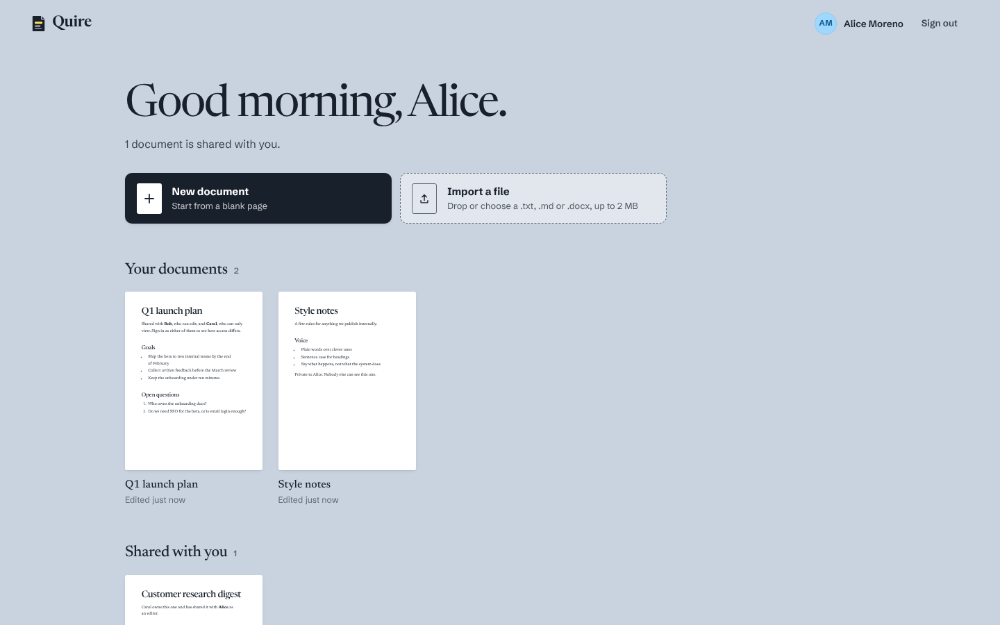

# Quire

A small collaborative document editor. You can write rich-text documents, turn `.txt`, `.md` and `.docx` files into editable documents, share them as editors or viewers, see who else has a document open, watch their edits arrive, and restore any earlier version.

**Live app (full stack):** https://quire-ilb6.onrender.com
**Browser demo (no server):** https://claude.ai/artifact/YCwQ4hzAE6CtxvCk1e9v3g
**Walkthrough video:** see `VIDEO_URL.txt`



## Demo accounts

All three use the password **`quire-demo`**. The login screen has one-click buttons for them.

| Account           | What it shows                                                                |
| ----------------- | ---------------------------------------------------------------------------- |
| `alice@ajaia.dev` | Owns "Q1 launch plan" (shared with Bob and Carol) and has a private doc      |
| `bob@ajaia.dev`   | Can **edit** Alice's plan, and owns a private "Interview notes"             |
| `carol@ajaia.dev` | Can only **view** Alice's plan, and has shared her research doc with Alice  |

**The quickest demo:** open Alice in one window and Bob in a private window, both on "Q1 launch plan". Each sees the other's avatar, and whatever Bob types shows up on Alice's page within a second.

## Features

**Writing**
- Create, rename (click the title), edit and delete documents. Changes save about 0.7 s after you stop typing, and the header shows *Editing → Saving → Saved*.
- Body text, three heading levels, bold, italic, underline, strikethrough, bulleted and numbered lists, quotes, undo/redo. Keyboard shortcuts and Markdown shortcuts (`# `, `- `, `1. `, `> `) work.
- Saves survive a closed tab: the last save is sent with `keepalive` when the page unloads.

**Importing and exporting**
- Import `.txt`, `.md`/`.markdown` or `.docx` (up to 2 MB) by clicking **Import a file** or by dropping a file anywhere on the home screen. Each file becomes a new document, and headings, emphasis and lists come through. Unsupported or oversized files get a clear message. The limits are shown in the UI too.
- Download any document as Markdown, or print it or save it as a PDF. The print stylesheet prints just the page.

**Sharing and collaboration**
- The owner shares by email as **Can edit** or **Can view**, and can change or remove access. The home screen separates *Your documents* from *Shared with you*, and shared documents show the owner and your access.
- **Presence:** avatars show who else has the document open. A pulsing ring means that person is editing right now.
- **Live updates:** other people's saves appear on your page as they happen, for viewers too. If you're typing at the same moment, nothing is overwritten. You get a choice between *Use their version* and *Keep mine*.
- Removing someone's access, or deleting the document, closes it for anyone who has it open.

**Version history**
- The history panel lists versions by author and time. Saves by the same person within five minutes are grouped into one version. Click a version to preview it, then *Restore* it. A restore is itself a new version, so it can be undone.

**Quality**
- 30 API tests and 6 browser end-to-end tests, ESLint, Prettier and strict TypeScript, all run in GitHub Actions CI.
- Security: scrypt password hashing, httpOnly SameSite session cookies, HTML sanitized on every write, a strict CSP and other headers via helmet, sign-in rate limiting, and no detail about documents you can't access (you always get a 404).
- One JSON log line per API request, with an `X-Request-Id` header.

## Running locally

Requires **Node 20+** (22 recommended, see `.nvmrc`).

```bash
npm install
npm run build
npm start            # http://localhost:3001
```

One Node process serves both the API and the built client. The database is created at `server/data/quire.db` and seeded with the demo accounts on first boot. To start over with fresh data, stop the server and delete `server/data/`.

For development with hot reload, use two terminals:

```bash
npm run dev --workspace server   # API on :3001
npm run dev --workspace client   # Vite on :5173, proxies /api to :3001
```

## Tests and checks

```bash
npm test             # API tests (Vitest + Supertest, in-memory SQLite)
npm run test:e2e     # browser tests (Playwright). Run `npm run build` first
npm run check        # lint + format check + typecheck + API tests
```

Before the first e2e run, install the browser with `npx playwright install chromium`, or point `PLAYWRIGHT_CHROME` at an installed Chrome. The e2e suite starts its own server on a fresh database.

| Suite | What it covers |
| --- | --- |
| `server/test/documents.test.ts` | Auth, create/rename/edit/reopen round trip, sanitization, version conflicts, validation, the full sharing permission matrix, revoking access |
| `server/test/import.test.ts` | `.txt`, `.md` and real `.docx` import, plus the file type and size limits |
| `server/test/revisions.test.ts` | Version grouping (with an injected clock), restore, access rules on history |
| `server/test/live.test.ts` | Presence, broadcast scoping, the saver's role never leaking into broadcasts, closing streams on revoke |
| `server/test/security.test.ts` | Sign-in rate limit, security headers, preview truncation |
| `e2e/quire.spec.ts` | Format and reload; a viewer is read-only and sees live edits; unknown email and access removal; a forced two-editor conflict; Markdown import; restore from history and Markdown download |

## Configuration

| Variable        | Default                | Notes                                   |
| --------------- | ---------------------- | --------------------------------------- |
| `PORT`          | `3001`                 |                                         |
| `DATABASE_PATH` | `server/data/quire.db` | The directory is created if missing     |
| `CLIENT_DIST`   | `client/dist`          | Built SPA, served if present            |
| `NODE_ENV`      | –                      | `production` turns on `Secure` cookies  |

## Browser demo build

`npm run build:demo --workspace client` builds the same UI against an in-browser backend (`client/src/backend/demo.ts`), and writes it to `client/dist-demo/`. That backend follows the same rules as the server: roles, versioned saves and conflicts, version history, sanitizing and import. It stores data in the browser, with each tab signed in as its own person and tabs kept in sync over a BroadcastChannel. It's what the browser-demo link above runs, and it can be hosted as static files anywhere.

The build picks a backend through one alias (`@backend` in `vite.config.ts`), and both backends implement the interface in `client/src/backend/contract.ts`, so the UI code is identical. The demo is for trying the product. The real system is the server in `server/`.

## Deploying

The repo includes a `Dockerfile` and a Render blueprint (`render.yaml`).

1. Push the repo to GitHub. CI runs on every push.
2. On [Render](https://render.com), choose **New → Blueprint** and select the repo. It uses the free plan, so no payment is needed.
3. Wait for the health check at `/api/health` to pass, then open the URL.

The image runs on any Docker host. To keep data across deploys, mount a volume at `/data`. Render's free plan has no disk, so the database resets on redeploy or spin-down and the demo data is seeded again. Live presence is held in memory, so the service should run as a single instance (see ARCHITECTURE.md).

## Project layout

```
server/                Express API + SQLite
  src/app.ts             app wiring; createApp() is what tests use
  src/db.ts              schema and demo seed
  src/services/          auth, documents + permissions + revisions, import, live hub (SSE)
  src/routes/            HTTP layer: zod validation, status codes
  src/lib/               errors, sanitizer, rate limiter, request log, passwords, config
  test/                  API tests and a .docx fixture
client/                React + Vite + TipTap
  src/pages/             login, home, editor
  src/components/        toolbar, share dialog, history drawer, presence, import, modal, toasts
  src/hooks/             useAutosave (versioned saves), useDocumentChannel (live events)
  src/lib/               router with view transitions, caches, exporters, people colors
e2e/                   Playwright tests
.github/workflows/     CI: lint, types, API tests, browser tests, Docker build
docs/screenshots/
```

Also in this folder: [ARCHITECTURE.md](ARCHITECTURE.md), [AI_WORKFLOW.md](AI_WORKFLOW.md), [SUBMISSION.md](SUBMISSION.md).
